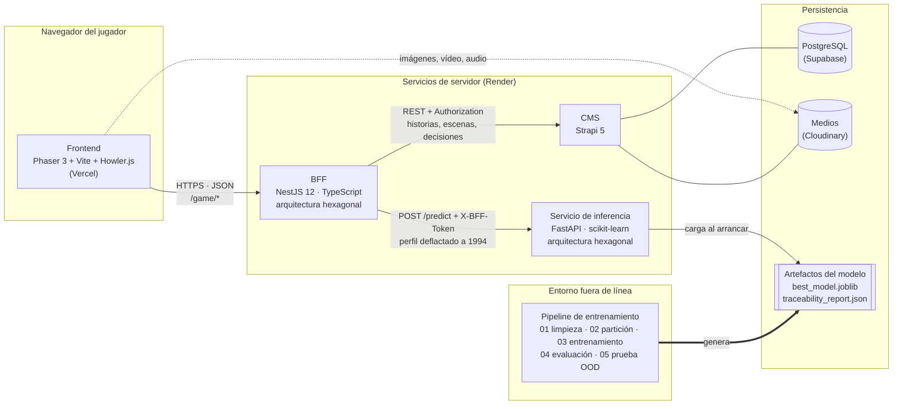

# Unfair Life

**Un videojuego narrativo sobre movilidad social, gobernado por un modelo de aprendizaje automático calibrado y auditable.**

Universidad Surcolombiana · Programa de Ingeniería de Software · Electiva en Ingeniería Aplicada II (*English and Data Science Fundamentals*) · Octubre de 2026

Equipo: Daniel Felipe Ordoñez Amaya, Nicolas Tamayo Melo, Juan David Rivera Chate. Directora: Daniela Alarcon Sepulveda.

---

## 1. Propósito científico

*Unfair Life* plantea una pregunta empírica bajo la forma de un juego: **¿en qué medida el origen de una persona determina su destino económico, y en qué medida queda en manos de factores que ningún dato registra?**

El jugador recorre historias cuyo desenlace no lo decide un guionista, sino un modelo entrenado con el censo *Adult Income* de 1994 (48 790 registros tras la limpieza). En cada encrucijada, el modelo estima la probabilidad de que el personaje supere un umbral de ingresos equivalente a 50 000 USD de 1994, que el proyecto denomina **movilidad**, y el juego actúa en consecuencia:

- Cuando el perfil censal determina el destino con una precisión de al menos el 95 %, el modelo decide.
- Cuando no lo determina, el juego lo reconoce explícitamente y lanza una **moneda ponderada** por esa probabilidad calibrada. El proyecto denomina a este mecanismo **suerte sistémica**.

La tesis del proyecto es que la parte del destino que no puede predecirse es una propiedad medible de los datos y no un defecto del modelo: personas con perfiles censales idénticos obtienen ingresos distintos. El sistema cuantifica esa frontera, la respeta y la convierte en mecánica de juego.

### Resultados principales (conjunto de prueba, nunca usado para decidir)

| Indicador | Valor |
|---|---|
| Registros limpios del censo | 48 790 (mínimo exigido: 35 000) |
| Modelo desplegado | Ensamble *stacking*: *gradient boosting* por histogramas + regresión logística, combinados por una regresión logística sobre sus *log-odds* |
| Discriminación | ROC-AUC 0,931 (IC 95 % *bootstrap*: 0,926–0,936); Gini 0,863 |
| Calibración | Brier 0,0863; pendiente de calibración 1,02 |
| Precisión de la decisión «movilidad» | 95,69 % (928 decisiones) |
| Precisión de la decisión «sin movilidad» | 95,41 % (6342 decisiones) |
| Cobertura determinista | 74,50 % de los casos; el 25,50 % restante se resuelve con la moneda ponderada |
| Exactitud esperada del juego, incluida la suerte | 85,22 % (2000 partidas simuladas: 84,74 %–85,68 %) |
| Validación fuera de distribución | ACS 2018, California y Nueva York (298 686 personas), con diagnóstico de *concept drift* y recalibración asimétrica |

La procedencia de cada cifra está documentada en [`ai-service/docs/01_TRACEABILITY.md`](ai-service/docs/01_TRACEABILITY.md).

---

## 2. Arquitectura

El sistema se compone de cuatro servicios independientes. El cliente del juego solo conoce al BFF; el BFF es el único componente que habla con el CMS y con el servicio de inteligencia artificial, y lo hace con un secreto compartido.



### 2.1. Componentes

| Componente | Carpeta | Tecnología | Despliegue | Responsabilidad |
|---|---|---|---|---|
| Cliente del juego | [`frontend/`](frontend) | Phaser 3, Vite, Howler.js | Vercel | Renderiza escenas, temporizadores y audio; envía únicamente el identificador de la escena y de la decisión elegida |
| *Backend for Frontend* | [`bff-api/`](bff-api) | NestJS 12, TypeScript, Vitest | Render | Resuelve el grafo narrativo, inyecta el contexto de cada decisión, ajusta por inflación, consulta a la IA, lanza la moneda criptográfica y registra cada tirada |
| Gestor de contenidos | [`cms/`](cms) | Strapi 5, PostgreSQL, Cloudinary | Render + Supabase | Almacena historias, escenas, decisiones, perfiles base y modificadores ocultos; valida el contenido al guardarlo |
| Servicio de inferencia | [`ai-service/inference-api/`](ai-service/inference-api) | FastAPI, Pydantic, scikit-learn | Render | Sirve `POST /predict` y `GET /health`; aplica la política de clasificación selectiva leída de los artefactos |
| *Pipeline* de entrenamiento | [`ai-service/training-pipeline/`](ai-service/training-pipeline) | pandas, scikit-learn, imbalanced-learn, SHAP | Fuera de línea | Limpia, particiona, entrena, evalúa y exporta los artefactos; nunca se ejecuta en producción |

### 2.2. Principios de diseño

1. **Separación estricta de responsabilidades.** El cliente no contiene reglas del juego, el BFF no contiene lógica de aprendizaje automático y el servicio de inferencia no conoce la narrativa. La justificación de cada capa está en [`ARCHITECTURE.md`](ARCHITECTURE.md).
2. **Arquitectura hexagonal.** Tanto el BFF como el servicio de inferencia separan el dominio (entidades, políticas y servicios puros) de los adaptadores (HTTP, Strapi, scikit-learn, aleatoriedad). Las reglas del juego son comprobables sin red ni base de datos.
3. **Estado autoritativo en el servidor.** El perfil del personaje y los modificadores de cada decisión residen en el CMS y nunca viajan al navegador. Ningún cliente puede proponer un perfil más favorable.
4. **Un único modelo, documentado y servido.** El servicio de inferencia carga los mismos ficheros que evaluó el *pipeline* y lee de `traceability_report.json` los límites de la banda de decisión. Si los artefactos son incoherentes entre sí, el servicio no arranca.
5. **Auditabilidad.** Cada prueba de movilidad deja una línea de registro con el perfil exacto enviado al modelo, la probabilidad, la zona, la tirada y el resultado, suficiente para reproducirla fuera de línea.

### 2.3. Flujo de una decisión

1. El jugador elige una opción. El cliente envía `POST /game/decision` con `{currentNodeId, decisionId}`.
2. El BFF obtiene la escena del CMS, toma el perfil base de la historia y le aplica los modificadores ocultos de la decisión.
3. El BFF deflacta las cantidades monetarias a dólares de 1994 con el IPC-U oficial (serie CUUR0000SA0).
4. El BFF llama a `POST /predict`. El servicio de inferencia devuelve la probabilidad calibrada y su zona: `mobility` si $p \ge 0{,}78$, `no_mobility` si $p \le 0{,}23$ y `uncertain` en otro caso.
5. En las zonas deterministas decide el modelo. En la zona incierta, el BFF genera una tirada uniforme con `crypto.randomInt` y concede movilidad si la tirada es menor que $p$.
6. El BFF devuelve la escena de éxito o de fracaso, sin exponer la probabilidad ni los modificadores.

El recorrido completo, paso a paso y con un ejemplo numérico real, está en [`ai-service/docs/01_TRACEABILITY.md`](ai-service/docs/01_TRACEABILITY.md), sección 4.

---

## 3. Documentación técnica

| Documento | Contenido |
|---|---|
| [`ARCHITECTURE.md`](ARCHITECTURE.md) | Arquitectura de referencia de los cuatro servicios |
| [`ai-service/docs/01_TRACEABILITY.md`](ai-service/docs/01_TRACEABILITY.md) | Cadena de evidencia desde el censo hasta producción, simulaciones y recorrido de una petición |
| [`ai-service/docs/02_MATHEMATICS.md`](ai-service/docs/02_MATHEMATICS.md) | Las catorce ecuaciones del modelo y las diecisiete figuras descriptivas |
| [`ai-service/docs/03_IMPLEMENTATION_AND_BALANCE.md`](ai-service/docs/03_IMPLEMENTATION_AND_BALANCE.md) | Volumen y balanceo de datos, criterio de precisión y las diez funcionalidades |
| [`ai-service/docs/04_MODEL_SELECTION.md`](ai-service/docs/04_MODEL_SELECTION.md) | Estado del arte y selección de los cuatro modelos y del ensamble |
| [`ai-service/docs/05_ADVANCED_EVALUATION.md`](ai-service/docs/05_ADVANCED_EVALUATION.md) | Curvas ROC y PR, validación cruzada repetida, curvas de aprendizaje, hiperparámetros, residuos y techo de precisión |
| [`ai-service/docs/06_METHODOLOGICAL_DEFENSE.md`](ai-service/docs/06_METHODOLOGICAL_DEFENSE.md) | Defensa de las decisiones metodológicas frente a las objeciones previsibles |
| [`ai-service/docs/paper/PAPER_DRAFT.md`](ai-service/docs/paper/PAPER_DRAFT.md) | Borrador de referencia del artículo (la versión oficial se entrega por separado) |

---

## 4. Requisitos técnicos

| Requisito | Versión |
|---|---|
| Node.js | 20 o superior (CMS: `>=20.0.0 <=26.x.x`) |
| npm | 6 o superior |
| Python | 3.10 o superior; los artefactos se generaron con Python 3.14 |
| scikit-learn | 1.9.1, fijado en `inference-api/requirements.txt` porque los artefactos `joblib` dependen de la versión que los entrenó |
| Base de datos | SQLite en desarrollo; PostgreSQL (Supabase) en producción |
| Almacenamiento de medios | Disco local en desarrollo; Cloudinary en producción |

Los tres servicios de servidor comparten un secreto, `BFF_SECRET_TOKEN`, que debe ser idéntico en `bff-api/.env`, `cms/.env` y `ai-service/inference-api/.env`. Cada servicio incluye un `.env.example` documentado con todas sus variables.

---

## 5. Ejecución local

Cada servicio se ejecuta en su propia terminal. Puertos por defecto: CMS 1337, servicio de inferencia 8000, BFF 3000 y cliente 5173.

**1. CMS.** En el primer arranque crea la historia «Turno de Noche» (desactivable con `SEED_STORIES=false`).

```bash
cd cms && npm install && npm run develop
```

**2. Servicio de inferencia.** Lee los artefactos de `ai-service/training-pipeline/artifacts/`.

```bash
cd ai-service/inference-api && python -m venv .venv && .venv/Scripts/pip install -r requirements.txt && .venv/Scripts/python main.py
```

**3. BFF.**

```bash
cd bff-api && npm install && npm run start:dev
```

**4. Cliente del juego.** La URL del BFF se configura con `VITE_BFF_URL` (por defecto, `http://localhost:3000`).

```bash
cd frontend && npm install && npm run dev
```

En Linux o macOS, las rutas `.venv/Scripts/` se sustituyen por `.venv/bin/`.

### 5.1. Reproducir el modelo

Todo componente aleatorio usa la semilla 42, de modo que una nueva ejecución reproduce los artefactos cifra por cifra.

```bash
cd ai-service/training-pipeline && python -m venv .venv && .venv/Scripts/pip install -r requirements.txt
```

```bash
cd ai-service/training-pipeline && .venv/Scripts/python src/01_data_cleaner.py && .venv/Scripts/python src/02_balancer.py && .venv/Scripts/python src/03_trainer.py && .venv/Scripts/python src/04_evaluator.py
```

Las figuras y los análisis complementarios se regeneran con `notebooks/01_math_and_eda.ipynb`, `src/generate_extra_plots.py` y `src/advanced_metrics.py`, y la prueba fuera de distribución con `ai-service/05_ood_testing.py`. El detalle está en [`ai-service/training-pipeline/README.md`](ai-service/training-pipeline/README.md).

### 5.2. Pruebas

```bash
cd bff-api && npm test
```

```bash
cd bff-api && npm run test:e2e
```

```bash
cd ai-service/inference-api && .venv/Scripts/python scripts/smoke_test.py
```

---

## 6. Estructura del repositorio

```
unfair-life/
├── ARCHITECTURE.md              Arquitectura de referencia
├── frontend/                    Cliente del juego (Phaser 3, Vite)
├── bff-api/                     Backend for Frontend (NestJS)
│   ├── src/core/                Dominio y casos de uso (sin dependencias externas)
│   ├── src/infrastructure/      Adaptadores: HTTP, Strapi, IA, aleatoriedad
│   └── test/                    Pruebas de extremo a extremo
├── cms/                         Gestor de contenidos (Strapi 5)
│   └── src/seeds/               Historia de referencia «Turno de Noche»
└── ai-service/
    ├── docs/                    Documentación científica y técnica
    ├── training-pipeline/       Pipeline fuera de línea, datos y artefactos
    ├── inference-api/           Servicio de inferencia (FastAPI)
    └── 05_ood_testing.py        Prueba fuera de distribución (ACS 2018)
```

---

## 7. Limitaciones conocidas

- **Datos de 1994.** El modelo aprendió la relación entre perfil e ingreso de una economía concreta. La prueba con la ACS 2018 muestra que esa relación se ha desplazado (*concept drift*), sobre todo en ocupaciones feminizadas; el análisis y la política de recalibración están en [`01_TRACEABILITY.md`](ai-service/docs/01_TRACEABILITY.md), sección 3.6.
- **Sesgos del censo.** El modelo reproduce desigualdades presentes en los datos, entre ellas la penalización por ser mujer. El proyecto las hace visibles mediante SHAP en lugar de ocultarlas, porque exponerlas es el propósito del juego.
- **Rasgos no observados.** Ningún modelo basado en estos trece rasgos puede superar un techo de exactitud cercano al 87 %. El proyecto lo cuantifica y lo trata como resultado científico ([`06_METHODOLOGICAL_DEFENSE.md`](ai-service/docs/06_METHODOLOGICAL_DEFENSE.md)).

---

## 8. Fuentes de datos

- Becker, B. y Kohavi, R. (1996). *Adult* [conjunto de datos]. UCI Machine Learning Repository.
- U.S. Census Bureau. *American Community Survey 2018, Public Use Microdata Sample*, a través de `folktables` (Ding, Hardt, Miller y Schmidt, 2021).
- U.S. Bureau of Labor Statistics. *Consumer Price Index for All Urban Consumers (CPI-U)*, serie CUUR0000SA0.
