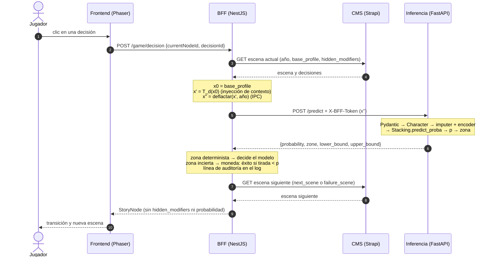

# Trazabilidad del Modelo de Movilidad Social

> **Ámbito.** Este documento describe la trazabilidad de los datos y de los resultados del modelo predictivo de *Unfair Life*: de dónde proviene cada cifra, qué artefacto la registra y cómo se garantiza que el modelo documentado es el mismo que atiende las peticiones en producción. Deliberadamente, no aborda la formulación matemática de los métodos ni la funcionalidad del juego. Esos temas se tratan en otros documentos.
>
> **Resultado esperado frente a resultado obtenido.** Cada prueba de este documento declara primero el **resultado esperado**, fijado *a priori* por un requisito, por la teoría o por un cálculo analítico, y después el **resultado obtenido**, leído del artefacto que lo registra. Cada contraste se justifica en dos planos: el matemático, que explica por qué la diferencia observada es la que la teoría admite, y el narrativo, que explica qué significa ese resultado para el jugador de *Unfair Life*. La sección 4 recorre una petición real del juego, desde el clic del jugador hasta la predicción, y la sección 6 resume todos los contrastes.

---

## 1. Principio rector

El *pipeline* de entrenamiento (`ai-service/training-pipeline`) se organiza como una cadena de cuatro etapas secuenciales. Cada etapa consume exclusivamente lo que produjo la anterior y deja constancia de su resultado en un informe en formato JSON. Ninguna cifra que se reporte sobre el modelo existe fuera de estos informes, y ningún informe se redacta a mano: todos son escritos por el propio código en el momento de su ejecución.

La cadena de evidencia es la siguiente:

```
cleaning_report.json  →  balancing_report.json  →  model_comparison.json  →  traceability_report.json
   (01_data_cleaner)        (02_balancer)             (03_trainer)              (04_evaluator)
```

Cada informe cumple una doble función: documenta lo que ocurrió en su etapa y funciona como punto de control verificable para la etapa siguiente. De este modo, cualquier resultado final puede rastrearse hacia atrás, eslabón por eslabón, hasta el registro censal original.

---

## 2. Evolución de los datos a través de los artefactos

### 2.1. `cleaning_report.json` — El punto de partida verificable

**Ubicación:** `training-pipeline/data/processed/cleaning_report.json`
**Productor:** `src/01_data_cleaner.py`

Este informe certifica el estado de los datos en el momento en que abandonan su forma cruda. La fuente única es el censo *Adult Income* de 1994 (`data/raw/income-dataset.csv`). Los ficheros del Banco Mundial (*socialLatino*) se excluyeron de forma deliberada: describen países y no personas, y solo podían vincularse a una fracción marginal de los individuos.

El informe registra que el conjunto original contenía **48 842 registros y 15 columnas**. Documenta los valores ausentes por columna (2799 en `workclass`, 2809 en `occupation` y 857 en `native_country`), que se conservaron bajo la categoría explícita *Unknown* en lugar de descartarse. También deja constancia de que no fue necesario eliminar ninguna fila por carecer de la etiqueta o de valores numéricos, y de que se suprimieron **52 registros duplicados**. El resultado es un conjunto limpio de **48 790 registros**, con 37 109 casos negativos y 11 681 positivos, es decir, una tasa de movilidad observada cercana al **23,9 %**.

**Aporte al ciclo de vida.** Establece la línea base contra la que se contrasta todo lo posterior. Si una etapa ulterior reporta un número de registros o una proporción de clases distinta, la discrepancia es detectable de inmediato. Además, la tasa de movilidad del 23,9 % se convierte aquí en la referencia que deben preservar todas las particiones siguientes.

#### Prueba 1 · Resultado esperado frente a resultado obtenido

| Verificación | Resultado esperado | Fundamento del valor esperado | Resultado obtenido |
|---|---|---|---|
| Volumen tras la limpieza | ≥ 35 000 registros | Requisito del proyecto | **48 790** registros (+39,4 %) |
| Tasa de movilidad | ≈ 24 % | Proporción documentada del censo *Adult Income* | **23,94 %** |
| Duplicados eliminados | Una fracción mínima del total (< 1 %) | Muestreo censal independiente por persona | **52** registros (0,11 %) |
| Filas descartadas por datos ausentes | 0 | Los ausentes se conservan como *Unknown* | **0** |

**Justificación matemática.** La tasa obtenida coincide con la documentada para este censo, lo que confirma que la limpieza no alteró la distribución de la variable objetivo. Eliminar 52 filas de 48 842 cambia esa tasa en menos de una diezmilésima, y conservar los ausentes como categoría evita el sesgo de selección que introduciría borrarlos (los datos ausentes en un censo no son aleatorios).

**Justificación narrativa.** El 23,94 % es la proporción de personas del censo que superaban el umbral de movilidad: la «regla del mundo» que el juego hereda. Si la limpieza la hubiera alterado, todos los personajes del juego vivirían en una sociedad más o menos desigual que la real.

### 2.2. `balancing_report.json` — La partición y el control de la fuga de información

**Ubicación:** `training-pipeline/data/processed/balancing_report.json`
**Productor:** `src/02_balancer.py`

Este informe documenta la decisión metodológica más sensible del *pipeline*: la separación de los datos **antes** de ajustar cualquier transformación. Parte exactamente de los 48 790 registros certificados por el informe anterior y verifica que superan el mínimo exigido de 35 000.

El informe registra una partición estratificada en tres subconjuntos con fines estrictamente separados:

| Subconjunto | Registros | Positivos | Función en el ciclo de vida |
|---|---:|---:|---|
| Entrenamiento | 29 274 | 7009 | Ajustar los modelos candidatos |
| Validación | 9758 | 2336 | Seleccionar el modelo y la política de decisión |
| Prueba | 9758 | 2336 | Emitir el veredicto final, una única vez |

Los tres subconjuntos conservan la tasa de movilidad del 23,9 % heredada de `cleaning_report.json`, lo que confirma que la estratificación se aplicó correctamente.

El informe documenta además el **balanceo sintético** del conjunto de entrenamiento mediante SMOTENC, configurado con cinco vecinos y la semilla 42. Este procedimiento generó 15 256 registros sintéticos y produjo una copia equilibrada de 44 530 filas, mitad por cada clase. Cabe subrayar que el balanceo se aplicó a una **copia** del conjunto de entrenamiento: los conjuntos de validación y prueba permanecen formados por personas reales y nunca se balancean. En esta etapa también se generan los artefactos de preprocesamiento (`imputer.joblib`, `encoder.joblib` y `feature_schema.json`), ajustados solo con los datos de entrenamiento.

**Aporte al ciclo de vida.** Garantiza que las métricas posteriores no estén contaminadas por información del conjunto de prueba. Al conservar dos versiones del entrenamiento, la natural y la balanceada, también permite que la etapa siguiente compare ambas con evidencia en lugar de suponer cuál es mejor.

#### Prueba 2 · Resultado esperado frente a resultado obtenido

| Verificación | Resultado esperado | Fundamento del valor esperado | Resultado obtenido |
|---|---|---|---|
| Tamaños de la partición 60/20/20 | 29 274 / 9758 / 9758 | 48 790 × (0,6 / 0,2 / 0,2) | **29 274 / 9758 / 9758** |
| Tasa de movilidad por subconjunto | 0,2394 en los tres, con una desviación máxima de una diezmilésima | La estratificación preserva la proporción salvo redondeo a filas enteras | **0,23943 / 0,23939 / 0,23939** |
| Clases tras SMOTENC | 22 265 / 22 265 | SMOTE iguala la clase minoritaria a la mayoritaria | **22 265 / 22 265** |
| Registros sintéticos | 15 256 | 22 265 − 7009 | **15 256** |

**Justificación matemática.** Todos los valores coinciden exactamente con los calculados de antemano. La desviación máxima de la tasa entre subconjuntos es de 0,00004, el mínimo que permite repartir personas enteras. Que los conjuntos de validación y prueba no contengan registros sintéticos garantiza que todas las métricas posteriores se miden sobre la distribución real.

**Justificación narrativa.** Los tres subconjuntos son tres «sociedades» con la misma desigualdad que el censo. El modelo se examina en una sociedad que nunca vio, y en ella solo hay personas reales, no personajes inventados por SMOTE.

### 2.3. `model_comparison.json` — La comparación de modelos y la construcción del ensamble

**Ubicación:** `training-pipeline/artifacts/model_comparison.json`
**Productor:** `src/03_trainer.py`

Este informe registra la competición entre modelos candidatos, la construcción del modelo desplegado y la justificación de su arquitectura. Se entrenaron cinco familias de algoritmos (regresión logística, k vecinos más cercanos, máquina de soporte vectorial calibrada, bosque aleatorio y *gradient boosting* por histogramas), cada una tanto con la versión natural como con la versión balanceada del conjunto de entrenamiento descrito en `balancing_report.json`. A ellas se suma una variante del *gradient boosting* ponderada por clase, entrenada solo con la distribución natural porque los pesos de clase y SMOTE son remedios alternativos al mismo problema. En total son once candidatos. La justificación teórica de esta selección se desarrolla en `04_MODEL_SELECTION.md`.

Todos los candidatos se evaluaron sobre el mismo conjunto de validación y se ordenaron con una regla fijada de antemano y registrada en el propio informe: mayor precisión promedio en validación y, en caso de empate, menor puntuación de Brier. El mejor candidato individual (`best_single_model`) fue **HistGradientBoosting entrenado con la distribución natural**, con una precisión promedio de **0,830** frente a 0,768 del mejor modelo lineal.

El modelo desplegado no es, sin embargo, un candidato individual, sino un **ensamble Stacking** de dos capas, documentado en la sección `stacking` del informe. La primera capa combina los dos modelos de sesgos inductivos más complementarios: HistGradientBoosting, flexible y no lineal, y la regresión logística, rígida y lineal. La segunda capa es una regresión logística que aprende a combinar sus log-odds a partir de predicciones fuera de pliegue, obtenidas con validación cruzada estratificada de cinco pliegues. El informe registra los pesos aprendidos por esa segunda capa (0,885 para el *gradient boosting* y 0,101 para la regresión logística). También registra la ganancia frente al mejor candidato individual: la precisión promedio se mantiene en 0,830, y el error de calibración esperado (ECE) desciende de 0,0096 a **0,0073**, una mejora del 24 %.

El informe incluye dos **estudios de ablación**:

- **Balanceo sintético (`smote_ablation`).** Para las cinco familias, entrenar con datos balanceados redujo la precisión promedio y distorsionó las probabilidades predichas, que pasaron a sobrestimar la movilidad real. Esta evidencia justifica que el modelo desplegado se haya entrenado sin SMOTE, aunque el balanceo se hubiera preparado en la etapa anterior.
- **Composición del ensamble (`stacking_ablation`).** Añadir un bosque aleatorio, o un bosque aleatorio y k vecinos más cercanos, a la primera capa no mejora de forma apreciable ninguna métrica y empeora ligeramente la calibración (ECE de 0,0079). El modelo de vecinos recibe además un peso nulo, y estas variantes multiplican por catorce o más el tamaño del fichero serializado (de 0,43 MB a 5,96 MB y 6,91 MB). La arquitectura desplegada es, por tanto, la más parsimoniosa entre las de rendimiento equivalente.

Tras guardar el ensamble en `best_model.joblib`, el *script* realiza dos verificaciones, y si cualquiera falla, la ejecución se interrumpe con un error:

1. Comprueba que la salida del ensamble es exactamente la combinación ponderada de las salidas de sus dos modelos base, con una desviación máxima de 1,8 × 10⁻¹⁵, es decir, error de redondeo de máquina.
2. Vuelve a cargar el fichero desde disco y comprueba que reproduce exactamente sus predicciones de validación.

**Aporte al ciclo de vida.** Convierte la construcción del modelo en una decisión auditable: el informe muestra qué se comparó, con qué criterio, cómo se combinaron los mejores modelos y por qué se descartaron las alternativas. Además, certifica que el fichero `best_model.joblib` es fiel al modelo que obtuvo esos resultados.

#### Prueba 3 · Resultado esperado frente a resultado obtenido

| Verificación | Resultado esperado | Fundamento del valor esperado | Resultado obtenido |
|---|---|---|---|
| Mejor discriminación individual | El *gradient boosting* | Estado del arte en datos tabulares (`04_MODEL_SELECTION.md`) | **HistGradientBoosting**, precisión promedio 0,830 |
| Mejor calibración individual | La regresión logística | Máxima verosimilitud y baja varianza | **Regresión logística**, ECE 0,0080 |
| Efecto de SMOTE en la probabilidad media | Aumento desde 0,24 hacia 0,50 (cota teórica) | Entrenar con *a priori* 50/50 multiplica los *odds* por ≈ 3,2 | De 0,241 a **0,303–0,352** (media 0,330) en las cinco familias |
| Efecto de SMOTE en la precisión promedio | Sin mejora | El reequilibrio no añade información para ordenar casos | **Empeora en las cinco familias** (de −0,008 a −0,050) |
| Precisión promedio del ensamble | ≥ la del mejor modelo individual (0,8303) | Un ensamble no debe perder discriminación | **0,8303** (+0,00006) |
| Calibración del ensamble | ECE ≤ 0,0096 | La combinación en escala logit preserva la calibración | **0,0073** (−24 %) |
| Pesos del meta-learner | $w_{\text{hgb}} + w_{\text{lr}} \approx 1$ y $b \approx 0$ | Modelos base ya calibrados no necesitan corrección | $w$ = 0,885 + 0,101 = **0,986**; $b$ = **0,011** |
| Aditividad del ensamble | Desviación ≤ 10⁻⁹ | Tolerancia fijada en `03_trainer.py` | **1,8 × 10⁻¹⁵** |
| Recarga de `best_model.joblib` | Predicciones idénticas | La serialización no debe alterar el modelo | **Idénticas** (verificación superada) |

**Justificación matemática.** Las expectativas teóricas se confirmaron sin excepción. El caso de SMOTE es el más ilustrativo. Si un modelo aprende con una proporción artificial de 50/50, sus *odds* quedan multiplicados por (0,5/0,5)/(0,239/0,761) ≈ 3,2, lo que en el límite llevaría una probabilidad de 0,24 hasta 0,50. Las probabilidades medias observadas (0,30 a 0,35) se sitúan dentro de ese intervalo teórico: el desplazamiento es parcial porque los modelos regularizados no absorben por completo el nuevo *a priori*. La suma de pesos del meta-learner (0,986) y su intercepto casi nulo (0,011) confirman que los modelos base ya estaban calibrados, porque el meta-learner los promedió en lugar de corregirlos.

**Justificación narrativa.** Un modelo entrenado con SMOTE habría hecho del juego una fantasía optimista: habría prometido movilidad a un tercio de los personajes cuando en la realidad la alcanza menos de un cuarto. El ensamble elegido conserva la proporción real, así que la suerte que el juego reparte tiene el peso que tiene en el mundo.

### 2.4. `traceability_report.json` — El veredicto final y el contrato con producción

**Ubicación:** `training-pipeline/artifacts/traceability_report.json`
**Productor:** `src/04_evaluator.py`

Este es el eslabón final y el más relevante de la cadena. El evaluador lee `model_comparison.json` para identificar el modelo seleccionado, carga `best_model.joblib` y verifica que los conjuntos de validación y prueba conservan exactamente las columnas declaradas en `feature_schema.json`. Si cualquiera de estas condiciones falla, se niega a continuar.

El informe cumple dos funciones:

1. **Registro del veredicto.** Contiene la evaluación del modelo sobre el conjunto de prueba, utilizado aquí por primera y única vez. Por ejemplo, el ensamble decide de forma determinista el **74,50 %** de los casos de prueba con una exactitud del **95,45 %** sobre esos casos, y el resto queda en una zona de incertidumbre. Las cifras de prueba son prácticamente idénticas a las de validación, lo que indica que la política de decisión no se sobreajustó al conjunto con el que fue elegida.
2. **Contrato con producción.** La sección `decision_policy` fija los parámetros con los que el modelo debe operar en el juego: la banda de incertidumbre, entre 0,23 y 0,78, y el umbral determinista, 0,7782. Estos valores no se copian manualmente al servicio de inferencia: la API los lee directamente de este fichero al arrancar.

El informe registra además la fecha y hora de su generación, el nombre y la clase del modelo evaluado (`StackingClassifier`), la ruta del fichero que lo contiene y, copiadas desde `model_comparison.json`, la arquitectura del ensamble y los pesos de su segunda capa. El contrato con producción describe así, por sí solo, exactamente qué modelo se sirve.

**Aporte al ciclo de vida.** Cierra la cadena de evidencia y la conecta con el sistema desplegado. Es el único documento que la API consulta, de modo que cualquier afirmación sobre el comportamiento del modelo en producción remite, en última instancia, a este fichero.

#### Prueba 4 · Resultado esperado frente a resultado obtenido

| Verificación (conjunto de prueba) | Resultado esperado | Fundamento del valor esperado | Resultado obtenido |
|---|---|---|---|
| Precisión de la decisión «movilidad» | ≥ 95 % | Restricción impuesta en validación (95,36 %) | **95,69 %** (IC Wilson 94,18 %–96,82 %) |
| Precisión de la decisión «sin movilidad» | ≥ 95 % | Restricción impuesta en validación (95,24 %) | **95,41 %** (IC Wilson 94,87 %–95,90 %) |
| Cobertura determinista | ≈ 74,5 % | Cobertura alcanzada en validación (74,50 %) | **74,50 %** |
| Exactitud sobre los casos decididos | ≈ 95,2 % | Valor alcanzado en validación (95,25 %) | **95,45 %** |
| Tasa real dentro de la banda frente a probabilidad media | Iguales salvo error muestral | Un modelo calibrado predice la frecuencia | **46,50 %** real frente a **49,02 %** predicha |

**Justificación matemática.** La banda se eligió en validación y se aplicó congelada a un conjunto nunca visto. Si el procedimiento sobreajustara, la precisión en prueba caería por debajo del 95 %. Ocurrió lo contrario: las dos precisiones quedaron ligeramente por encima de sus valores de validación y la cobertura fue idéntica. Las diferencias son de unas décimas, muy inferiores a la anchura de los intervalos de Wilson, y por tanto compatibles con la variación muestral. Dentro de la banda, la frecuencia real (46,50 %) y la probabilidad media (49,02 %) difieren en 2,5 puntos, lo que confirma una calibración aceptable justo en la región donde decide la moneda.

**Justificación narrativa.** Cuando el juego afirma con certeza «tu personaje asciende» o «no asciende», acierta en más de 95 de cada 100 casos. Cuando no puede afirmarlo, lo reconoce y lanza una moneda cuyo peso refleja la realidad: en esa franja, casi la mitad de las personas reales lo lograron.

---

## 3. Simulación de resultados y reproducibilidad

### 3.1. La semilla 42 como hilo conductor

Todo componente aleatorio del *pipeline* se inicializa con la misma semilla fija, **42**:

- la partición estratificada en entrenamiento, validación y prueba (`02_balancer.py`);
- la generación de registros sintéticos con SMOTENC (`02_balancer.py`);
- la inicialización de cada modelo candidato que incorpora azar (`03_trainer.py`);
- los cinco pliegues de validación cruzada con los que se entrena la segunda capa del ensamble (`03_trainer.py`);
- las simulaciones de remuestreo y de lanzamiento de monedas (`04_evaluator.py`).

Fijar la semilla elimina la variabilidad entre ejecuciones. Ejecutar de nuevo el *pipeline* sobre los mismos datos de origen produce las mismas particiones, los mismos registros sintéticos, los mismos pliegues de validación cruzada, el mismo ensamble y, por tanto, los mismos informes, cifra por cifra. La reproducibilidad no es una aspiración, sino una propiedad verificable: cualquier evaluador puede regenerar los artefactos y compararlos con los publicados.

En el evaluador, cada simulación crea su propio generador de números aleatorios inicializado con la semilla 42, en lugar de compartir uno solo. Así, el resultado de una simulación no depende de cuántos números aleatorios haya consumido la otra, y ambas pueden reproducirse por separado.

### 3.2. Las 2000 iteraciones de remuestreo (*bootstrap*)

Una sola medición sobre el conjunto de prueba ofrece un valor puntual, pero no expresa cuánta confianza merece. Para cuantificarlo, el evaluador realiza **2000 iteraciones de remuestreo** del conjunto de prueba. En cada iteración se construye una muestra alternativa del mismo tamaño, extraída con reemplazo de los 9758 casos reales, y se recalcula la cobertura y la exactitud del modelo sobre ella.

El conjunto de 2000 resultados permite delimitar el rango en que se sitúan las métricas con un 95 % de confianza. Según `traceability_report.json`, la cobertura determinista se encuentra entre el **73,66 % y el 75,38 %**, y la exactitud sobre los casos decididos entre el **94,98 % y el 95,92 %**. Lo que estos rangos documentan es la estabilidad del modelo: su rendimiento no depende de una composición afortunada del conjunto de prueba.

#### Prueba 5 · Resultado esperado frente a resultado obtenido

| Verificación | Resultado esperado | Fundamento del valor esperado | Resultado obtenido |
|---|---|---|---|
| IC 95 % de la cobertura | [73,64 %; 75,37 %] | Aproximación normal: $0{,}7450 \pm 1{,}96\sqrt{0{,}7450 \cdot 0{,}2550 / 9758}$ | **[73,66 %; 75,38 %]** |
| IC 95 % de la exactitud sobre decididos | [94,97 %; 95,93 %] | Aproximación normal: $0{,}9545 \pm 1{,}96\sqrt{0{,}9545 \cdot 0{,}0455 / 7270}$ | **[94,98 %; 95,92 %]** |

**Justificación matemática.** El *bootstrap* no supone ninguna distribución y la fórmula normal sí. Que ambos coincidan hasta la segunda cifra decimal confirma que, con casi diez mil casos, los estimadores siguen la distribución normal que predice el teorema central del límite y que el remuestreo se implementó correctamente.

**Justificación narrativa.** Si el juego se jugara con otra muestra de diez mil personas reales, el modelo seguiría decidiendo con certeza en torno a tres de cada cuatro casos y seguiría acertando en torno a 95 de cada 100. El resultado no depende de una muestra afortunada.

### 3.3. La simulación de las 2000 monedas

Dentro de la banda de incertidumbre, el modelo no impone un resultado. El juego resuelve el destino del personaje con una **moneda ponderada** por la probabilidad que estima el modelo, y ese lanzamiento lo ejecuta el BFF. Como este mecanismo introduce azar en el resultado que experimenta el jugador, su comportamiento esperado también debe documentarse.

Para ello, el evaluador repite **2000 veces** la partida completa sobre el conjunto de prueba. En cada repetición, los casos fuera de la banda reciben la decisión determinista del modelo, y cada caso dentro de la banda se resuelve con un lanzamiento de moneda simulado. Después se mide qué proporción de los 9758 personajes recibió un desenlace coincidente con su realidad censal.

El resultado, registrado en la sección `game_mechanic` del informe, establece una exactitud esperada del **85,22 %** sobre todos los jugadores, con el 95 % de las partidas simuladas comprendidas entre el **84,74 % y el 85,68 %**. La simulación documenta así la experiencia del jugador tal como el juego la produce, incluido el componente de azar, y no solo el rendimiento abstracto del clasificador.

Conviene precisar el alcance de la semilla: garantiza que **la simulación** sea reproducible, no que lo sean los lanzamientos reales del juego. En producción, el BFF utiliza una fuente de aleatoriedad criptográfica para cada partida. Las 2000 monedas simuladas caracterizan la distribución de resultados que esos lanzamientos reales siguen, sin predeterminarlos.

#### Prueba 6 · Resultado esperado frente a resultado obtenido

| Verificación | Resultado esperado | Fundamento del valor esperado | Resultado obtenido |
|---|---|---|---|
| Centro de la distribución simulada | 85,22 % | Valor esperado analítico (`02_MATHEMATICS.md`, Ecuación 13) | Rango centrado en **85,21 %** |
| Anchura del rango del 95 % | ≤ 1,00 puntos | Cota superior: $2 \cdot 1{,}96 \sqrt{\sum_{i \in \text{banda}} \hat{p}_i(1-\hat{p}_i)} / N$, con $\hat{p}_i(1-\hat{p}_i) \le 0{,}25$ y 2488 casos en la banda | **0,94 puntos** (84,74 %–85,68 %) |

**Justificación matemática.** Cada lanzamiento de moneda dentro de la banda es una variable de Bernoulli independiente. La exactitud de una partida es, por tanto, una constante (los aciertos deterministas) más una suma de Bernoulli, cuya media es el valor analítico y cuya varianza es $\sum \hat{p}_i(1-\hat{p}_i)/N^2$. La simulación quedó centrada en el valor analítico y su anchura no superó la cota teórica, que se alcanzaría solo si todas las probabilidades de la banda valieran exactamente 0,5.

**Justificación narrativa.** Dos jugadores con el mismo personaje pueden vivir desenlaces distintos, y así es la suerte sistémica. Pero sobre miles de partidas el juego es predecible: acierta la realidad censal en torno a 85 de cada 100 personajes, ni más ni menos de lo que su diseño promete.

### 3.4. Garantía de identidad entre el modelo documentado y el modelo en producción

La trazabilidad quedaría incompleta si el modelo descrito en estos informes pudiera diferir del que responde las peticiones reales. Esa identidad se asegura mediante cuatro mecanismos complementarios:

1. **Artefactos compartidos, no duplicados.** El servicio de inferencia (`ai-service/inference-api`) no reentrena ni reconstruye el modelo. Carga directamente los mismos ficheros generados por el *pipeline*: `best_model.joblib`, `imputer.joblib`, `encoder.joblib`, `feature_schema.json` y `traceability_report.json`. El modelo que se evaluó y el modelo que se sirve son, literalmente, el mismo fichero.
2. **Política de decisión leída del informe.** La banda de incertidumbre y el umbral determinista no están codificados en la API: se obtienen de la sección `decision_policy` de `traceability_report.json` en cada arranque. Una nueva ejecución del evaluador se refleja en producción sin intervención manual, y no puede haber divergencia entre lo documentado y lo aplicado.
3. **Verificaciones de coherencia al arrancar.** Antes de aceptar peticiones, la API comprueba que el modelo ofrece probabilidades y que fue entrenado con las mismas columnas declaradas en `feature_schema.json`. También verifica que el imputador y el codificador reproducen exactamente ese esquema. Si cualquier artefacto es incoherente con los demás, el servicio no arranca, en lugar de servir predicciones de un modelo distinto al documentado.
4. **Reproducibilidad determinista.** Gracias a la semilla 42, cualquier tercero puede regenerar la cadena completa, desde `cleaning_report.json` hasta `traceability_report.json`, y obtener el mismo `best_model.joblib` con las mismas cifras. A ello se suman las verificaciones de `03_trainer.py`, que confirman que el ensamble combina exactamente sus modelos base y que el fichero guardado reproduce sus predicciones de validación. Juntas, ambas garantías cierran el círculo entre la ejecución que produjo los resultados y el artefacto que se despliega.

En conjunto, estos mecanismos aseguran que cada cifra de este documento describe exactamente el modelo que la API de producción utiliza: el mismo fichero, operando con los mismos parámetros y verificado contra el mismo esquema.

#### Prueba 7 · Resultado esperado frente a resultado obtenido

| Verificación | Resultado esperado | Fundamento del valor esperado | Resultado obtenido |
|---|---|---|---|
| Modelo que informa `GET /health` | `Stacking (HGB + LR -> LR) [natural]` | Nombre registrado en `traceability_report.json` | **El mismo** |
| Banda y umbral que aplica la API | [0,23; 0,78] y 0,7782 | Sección `decision_policy` del informe | **[0,23; 0,78] y 0,778227** |
| Arranque con artefactos coherentes | El servicio arranca y supera la prueba de humo | Verificaciones de coherencia de `sklearn_predictor.py` | **Arranque correcto y *smoke test* superado** |
| Acceso sin el secreto compartido | Rechazo con HTTP 403 | Dependencia `require_bff_token` | **403** |

**Justificación matemática.** La política que aplica la API es, valor por valor, la que el evaluador estimó. El umbral que devuelve el servicio (0,778227) es el del informe con todas sus cifras, lo que demuestra que se lee del artefacto y no se copia a mano.

**Justificación narrativa.** Lo que el equipo documentó y lo que el jugador experimenta son lo mismo. Ningún paso intermedio puede alterar en silencio las reglas con las que el juego decide el destino de un personaje.

### 3.5. Simulación de trazabilidad en el juego: «Turno de Noche»

Las pruebas anteriores validan el modelo sobre el conjunto de prueba. Esta sección valida la cadena completa en condiciones reales de juego: CMS, BFF, inyección de contexto, servicio de inferencia y moneda ponderada. La historia «Turno de Noche» se jugó a través del BFF sin enviar personaje, de modo que cada prueba de movilidad evaluó el perfil base de la historia más los modificadores ocultos de la decisión. Antes de jugarla, las probabilidades se habían calculado fuera de línea con los mismos artefactos.

**Primer contraste: probabilidades.** El resultado esperado es la probabilidad calculada fuera de línea durante el diseño de la historia; el obtenido es la registrada por el log de auditoría del BFF durante el juego.

| Camino (2033) | Resultado esperado: p (zona) | Resultado obtenido: p (zona) |
|---|---|---|
| Andrés se queda → enfermera | 0,435 (moneda) | **0,4354 (moneda)** |
| Andrés se queda → supervisora | 0,373 (moneda) | **0,3733 (moneda)** |
| Andrés migra → enfermera | 0,082 («no» determinista) | **0,0818 («no» determinista)** |
| Andrés migra → interna doméstica | 0,011 («no» determinista) | **0,0112 («no» determinista)** |
| Darién → técnica de enfermería | 0,256 (moneda) | **0,2564 (moneda)** |
| Darién → limpieza de oficinas | 0,063 («no» determinista) | **0,0626 («no» determinista)** |

**Segundo contraste: frecuencias de éxito.** Los tres caminos con moneda se jugaron 20 veces cada uno. El resultado esperado es $20\,p$ éxitos, con desviación típica binomial $\sqrt{20\,p\,(1-p)}$.

| Camino | Resultado esperado | Resultado obtenido | Desviación |
|---|---|---|---|
| Enfermera (p = 0,435) | 8,7 ± 2,2 éxitos | **10** | +0,6 desviaciones típicas |
| Supervisora (p = 0,373) | 7,5 ± 2,2 éxitos | **7** | −0,2 desviaciones típicas |
| Técnica en Houston (p = 0,256) | 5,1 ± 2,0 éxitos | **8** | +1,5 desviaciones típicas |

**Justificación matemática.** Las seis probabilidades del juego coinciden con las calculadas fuera de línea hasta la tercera cifra decimal. Esto prueba que la inyección de contexto, la deflación monetaria y el servicio de inferencia reproducen exactamente el modelo documentado. Las tres frecuencias de éxito quedan a menos de dos desviaciones típicas de su valor esperado, como corresponde a una moneda bien ponderada: con 20 lanzamientos, desviaciones de esa magnitud son normales. En los caminos deterministas, el desenlace improbable («Contra la estadística») no apareció nunca, como exige una probabilidad situada fuera de la banda.

**Justificación narrativa.** Las cifras sostienen el argumento de la historia. Mientras la familia permanece unida, el esfuerzo de Daniela la lleva a la zona donde la suerte decide, y el jugador ve que a veces sale y a veces no. Cuando la migración rompe el hogar, el modelo responde «no» antes de lanzar ninguna moneda, y el jugador comprende que no fue por falta de mérito. Que esos resultados reproduzcan con exactitud lo calculado demuestra que el mensaje del juego no es un efecto teatral, sino la consecuencia directa de lo que el modelo aprendió del censo.

**Tercer contraste: un lanzamiento individual.** En «La Prueba Definitiva», la prueba de movilidad registró p = 0,3305 (zona incierta) y una tirada de 0,1002. El resultado esperado, según la regla «movilidad si la tirada es menor que p», era movilidad, y el resultado obtenido fue **movilidad**. En «El Precio del Ascenso», p = 0,0015 situaba el caso en la zona determinista: se esperaba «sin movilidad» sin lanzar moneda, y eso fue exactamente lo registrado (`decidedBy=model`).

### 3.6. Prueba fuera de distribución: *Concept Drift* con la ACS 2018 (California y Nueva York)

Las pruebas 1 a 7 validan el modelo sobre personas del mismo censo de 1994 con el que se entrenó. Esta sección responde a una pregunta más exigente: ¿qué ocurre cuando el modelo, sin reentrenarse, evalúa a personas de otra población, otra encuesta y otra época económica? El *script* `05_ood_testing.py` aplica el modelo desplegado a la *American Community Survey* (ACS PUMS) de 2018, en la formulación *ACSIncome* de Ding et al. (2021), disponible a través de `folktables`. Sus resultados se persisten en `ood_results_CA.json` y `ood_results_NY.json`.

**Protocolo.** Se evaluaron **195 665** personas de California y **103 021** de Nueva York tras el filtro *ACSIncome* (edad > 16, ingreso > 100, horas > 0, peso ≥ 1). Los ingresos se llevaron primero a dólares de 2018 con el factor `ADJINC` y después a dólares de 1994 con la misma tabla IPC-U que usa el BFF (`consumer-price-index.ts`, leída en tiempo de ejecución), con un deflactor de 0,5902. La etiqueta se calcula **después** de la deflación, $y = \mathbb{1}(\text{ingreso}_{1994} > 50\,000)$, de modo que ambos conjuntos plantean la misma pregunta económica; en moneda de 2018, el umbral equivale a unos **84 719 USD**. Los rasgos ACS se recodificaron a las 13 variables y grafías del censo de 1994. El modelo, el imputador, el codificador y la banda [0,23; 0,78] son exactamente los artefactos de producción: `"retrained": false`.

**Diagnóstico de la deriva.** La capacidad de ordenar a las personas se transfiere de forma razonable, pero la calibración no:

| Métrica | Prueba 1994 | ACS 2018 · CA | ACS 2018 · NY |
|---|---:|---:|---:|
| ROC-AUC | 0,9313 | 0,8327 | 0,8022 |
| Brier | 0,0863 | 0,1401 | 0,1504 |
| ECE | — | 0,0663 | 0,0967 |
| Tasa real de movilidad | 23,94 % | 23,47 % | 21,25 % |
| Predicción media | — | 25,85 % | 27,28 % |
| Precisión «movilidad» (banda congelada) | 95,69 % | **70,52 %** | **63,47 %** |
| Precisión «sin movilidad» (banda congelada) | 95,41 % | **91,42 %** | **91,38 %** |
| Cobertura determinista | 74,50 % | 65,60 % | 63,47 % |

La tasa real apenas cambió en California (−0,5 puntos) y bajó 2,7 puntos en Nueva York, mientras que el modelo sobrestima la movilidad en 2,4 y 6,0 puntos respectivamente. El cambio en la tasa base (*prior shift*) es pequeño; lo que se desplazó es la **relación** entre el perfil y el ingreso, $P(Y \mid X)$. Esa es la firma del *concept drift*, y no un defecto del *pipeline*. La caída es, además, **asimétrica**: la decisión «movilidad» pierde 25 y 32 puntos de precisión, mientras que «sin movilidad» pierde solo 4.

**Recalibración asimétrica.** El modelo no se reentrena; solo se reestiman los cortes de la banda para la nueva población. La muestra de 2018 se dividió al 50 % de forma estratificada (semilla 42): en la mitad de adaptación se buscó la banda con **la misma regla** de `04_evaluator.choose_band` (importada, no reimplementada), y ambas políticas, la congelada de 1994 y la adaptada, se evaluaron sobre la mitad reservada, que no participó en la búsqueda.

1. **La adaptación bilateral es imposible.** Ningún corte superior alcanza el 95 % en «movilidad»: el mejor punto de la rejilla llega al **80,12 %** (CA) y al **79,55 %** (NY), ambos en $p \ge 0{,}92$. Si incluso las puntuaciones más altas fallan una de cada cinco veces, el problema no es el umbral sino el **orden**: el modelo coloca arriba a personas que en 2018 no superan el umbral, y ningún desplazamiento del corte lo repara. El resultado queda registrado como `TWO_SIDED_TARGET_NOT_REACHABLE`.
2. **La decisión «sin movilidad» sí se recupera.** El *script* recurre entonces a la abstención asimétrica: recalibra solo el corte inferior y envía toda puntuación superior a la moneda ponderada, sin «movilidad» determinista.

| Política sobre la mitad reservada | Corte | Cobertura | Precisión «sin movilidad» (IC 95 % Wilson) | Exactitud esperada del juego |
|---|---|---:|---:|---:|
| CA · banda congelada de 1994 | $p \le 0{,}23$ | 65,57 % | 91,53 % (91,30 – 91,75) | 77,27 % |
| CA · **recalibración asimétrica** | $p \le 0{,}08$ | 45,01 % | **95,34 % (95,14 – 95,53)** | 75,67 % |
| NY · banda congelada de 1994 | $p \le 0{,}23$ | 63,32 % | 91,52 % (91,19 – 91,83) | 75,53 % |
| NY · **recalibración asimétrica** | $p \le 0{,}07$ | 40,09 % | **95,81 % (95,53 – 96,08)** | 73,89 % |

En los dos estados, el límite inferior del intervalo de confianza queda por encima del 95 %: la garantía de precisión de la decisión «sin movilidad» se restituye en la población de 2018 con solo mover su corte.

**Por qué cae la decisión «movilidad»: el sesgo de las profesiones feminizadas.** Para explicar la asimetría, los falsos positivos de la zona «movilidad» ($p \ge 0{,}78$) se desglosaron por sexo y por grupo ocupacional, con los mismos registros, recodificación y modelo de `05_ood_testing.py`:

| Desglose (banda congelada) | CA | NY |
|---|---:|---:|
| Precisión «movilidad», mujeres | **59,32 %** (n = 6199) | **50,90 %** (n = 3782) |
| Precisión «movilidad», hombres | 83,17 % (n = 5490) | 80,44 % (n = 2802) |
| Precisión «sin movilidad», mujeres / hombres | 91,67 % / 91,18 % | 91,69 % / 91,05 % |
| Proporción de mujeres en la población evaluada | 47,2 % | 49,4 % |
| Proporción de mujeres entre los falsos «movilidad» | **73,2 %** | **77,2 %** |
| *Adm-clerical* (71 % / 73 % mujeres): precisión «movilidad» | 44,4 % | 41,7 % |
| *Prof-specialty* (53 % / 59 % mujeres): precisión «movilidad» | 65,1 % | 56,8 % |
| *Exec-managerial* (46 % mujeres): precisión «movilidad» | 80,8 % | 75,3 % |

El error se concentra en las mujeres y en los grupos ocupacionales más feminizados. *Prof-specialty* reúne por sí sola el 59 % (CA) y el 62 % (NY) de las decisiones «movilidad», y en 2018 agrupa profesiones de alta escolaridad y fuerte presencia femenina (docencia, enfermería, trabajo social) cuyo salario no acompaña al nivel educativo. El modelo de 1994 aprendió que un título universitario, una ocupación profesional y la jornada completa conducen a superar el umbral, y les asigna puntuaciones altas; la realidad de 2018 les paga por debajo de él. El lado bajo, en cambio, apenas distingue por sexo (91,7 % frente a 91,2 %), porque lo determinan rasgos cuya relación con el ingreso es estable (edad, horas, escolaridad baja). Esto explica la asimetría: la deriva afecta al orden en la cola alta, que no se puede recalibrar, y deja intacta la cola baja, que sí.

> **Nota de trazabilidad.** El desglose por sexo y ocupación lo recalcula `src/generate_extra_plots.py` con las funciones importadas de `05_ood_testing.py` (mismos registros, recodificación, deflación y modelo) y queda persistido en `training-pipeline/artifacts/extra_figures_report.json`, sección `concept_drift.subgroups`. Las cifras de la tabla coinciden con las persistidas hasta el último decimal. Las demás cifras de esta sección se leen de `ood_results_*.json`, y la figura `concept_drift.png` (`02_MATHEMATICS.md`, Figura 16) las muestra en un solo panel.

#### Prueba 8 · Resultado esperado frente a resultado obtenido

| Verificación | Resultado esperado | Fundamento del valor esperado | Resultado obtenido |
|---|---|---|---|
| Discriminación fuera de distribución | ROC-AUC < 0,9313 pero > 0,5 | La relación educación–ocupación–ingreso es estructuralmente estable | **0,8327 (CA) y 0,8022 (NY)** |
| Precisión con la banda congelada | < 95 % | *Concept drift*: $P(Y \mid X)$ cambió entre 1994 y 2018 | **70,52 % / 91,42 % (CA); 63,47 % / 91,38 % (NY)** |
| Adaptación bilateral | Alcanzable solo si el orden se conserva en la cola alta | Regla de `04_evaluator.choose_band` | **No alcanzable: máximo 80,12 % (CA) y 79,55 % (NY)** |
| Recalibración asimétrica de «sin movilidad» | ≥ 95 % en la mitad reservada | Mismo criterio que la prueba 4 | **95,34 % (CA) y 95,81 % (NY), IC inferior > 95 %** |
| Origen del error en «movilidad» | Concentrado en un subgrupo identificable | Hipótesis de la brecha salarial en profesiones feminizadas | **Mujeres: 73–77 % de los falsos positivos; precisión 59 % / 51 %** |

**Justificación matemática.** Un umbral solo puede corregir un error de calibración, no un error de orden. Si el mejor corte superior de toda la rejilla no pasa del 80 % de precisión, una de cada cinco personas a las que el modelo asigna sus puntuaciones más altas no supera el umbral: es un fallo de ordenación, y la única respuesta coherente con el criterio del 95 % es abstenerse. En la cola baja, en cambio, la precisión alcanza el 99,3 % en $p \le 0{,}01$, de modo que existe un corte (0,08 en CA y 0,07 en NY) que restituye la garantía, y el intervalo de Wilson sobre datos no vistos lo confirma.

**Justificación narrativa.** El modelo de 1994 sigue sabiendo reconocer quién **no** va a ascender, y con un ajuste mínimo lo dice con la misma seguridad en la California y el Nueva York de 2018. Lo que ya no sabe es prometer el ascenso a una profesional con título: el mundo le pagó menos de lo que su currículum anticipaba, y le pagó aún menos si era mujer. Ese fallo no es ruido, sino la propia desigualdad que el juego quiere mostrar, ahora medida fuera del censo con el que se construyó.

---

## 4. Trazabilidad de una partida: del clic del jugador a la predicción de la IA

Las secciones 2 y 3 siguen las cifras desde el censo hasta el modelo desplegado. Esta sección sigue el camino inverso: una **petición concreta**, desde que el jugador pulsa un botón en el navegador hasta que el modelo devuelve su probabilidad y el juego muestra la escena siguiente. Cada paso indica el fichero y la función que lo ejecutan, qué dato entra, qué dato sale y qué verificación impide que el dato se altere por el camino. Al final, la sección 4.3 recorre el mismo camino con las cifras reales de una decisión de «Turno de Noche», recalculadas fuera de línea y persistidas en `training-pipeline/artifacts/extra_figures_report.json`.

### 4.1. Vista general



### 4.2. Paso a paso

| # | Componente · fichero · función | Entra | Sale | Garantía que impide alterar el dato |
|---|---|---|---|---|
| 1 | **Frontend** · `frontend/src/scenes/Decision.js` · `#handleChoice` → `#lockInput` | Clic sobre un `ChoiceBtn` (o fin del temporizador) | La decisión elegida | `#lockInput` desactiva todos los botones: un doble clic no puede enviar dos decisiones. La elección se anota en el historial local (`playthroughHistory.recordChoice`). |
| 2 | **Frontend** · `Decision.js` · `#submit` → `frontend/src/api/bffClient.js` · `submitDecision` | `this.node.id`, `decision.id` | `POST /game/decision` con cuerpo `{currentNodeId, decisionId}` | El cliente **no envía ningún personaje**: no puede proponer un perfil más favorable. Si la decisión tiene `requiresMobilityCheck`, muestra «Life is weighing your chances...». Tiempo máximo de 120 s y cancelación si la escena cambia. |
| 3 | **BFF** · `bff-api/src/infrastructure/web/validation-pipe.ts`, `dtos/submit-choice.dto.ts` | JSON del cliente | `SubmitChoiceDto` validado | `whitelist` y `forbidNonWhitelisted`: un campo no declarado devuelve `400`; sin conversiones implícitas de tipo. |
| 4 | **BFF** · `web/controllers/game.controller.ts` · `decide` → `core/use-cases/resolve-decision.service.ts` · `execute` | `currentNodeId`, `decisionId` | Llamada al caso de uso | El controlador ignora cualquier `character` heredado: la prueba de movilidad usa solo el perfil del CMS. |
| 5 | **BFF → CMS** · `adapters/cms/strapi-content.adapter.ts` · `getStoryNode` y `strapi-mappers.ts` | Identificador de la escena | Entidad `StoryNode` con el año, el `base_profile` de la historia y, por decisión, `requires_mobility_check` y `hidden_modifiers` | La consulta pide solo los campos necesarios. `findDecision` rechaza una decisión que la escena no ofrece (`DecisionNotFoundError`, `400`). El CMS ya validó perfil y modificadores al guardarlos (`base-profile-validation.ts`, `hidden-modifiers-validation.ts`). |
| 6 | **BFF** · *etapa 0* · `resolve-decision.service.ts` | `StoryNode` | $x_0$ = `base_profile` | Sin perfil base, `BaseProfileRequiredError` (`422`): nunca se evalúa un personaje arbitrario. Si la decisión no exige prueba de movilidad, se salta directamente al paso 12. |
| 7 | **BFF** · *etapa 1* · `core/domain/services/context-injection.ts` · `injectContext` | $x_0$ y los modificadores $T_d$ de la decisión | $x' = T_d(x_0)$ y la lista de ajustes | Los enteros se **suman** y los textos **reemplazan**. Cada rasgo numérico se acota al dominio de entrenamiento (edad 17–90, educación 1–16, horas 1–99) y el ajuste queda marcado como `clamped`. El perfil base nunca se modifica. |
| 8 | **BFF** · *etapa 2* · `services/inflation-adjuster.ts` · `deflateToModelBaseYear` con `consumer-price-index.ts` | $x'$ y el año de la escena | $x''$: ganancias y pérdidas de capital en dólares de 1994 | Ecuación 14 de `02_MATHEMATICS.md`: $x^{(1994)} = x^{(t)} \cdot \mathrm{CPI}(1994)/\mathrm{CPI}(t)$. Es la misma tabla IPC-U que lee `05_ood_testing.py`. |
| 9 | **BFF → IA** · `adapters/ai/fast-api-predictor.adapter.ts` · `assessMobility` | $x''$ (camelCase) | `POST {AI_SERVICE_URL}/predict` en snake_case, con la cabecera `X-BFF-Token` | `toPredictionPayload` solo renombra campos. Un `401`/`403` se registra como secreto incorrecto y el cliente recibe `502`; una caída o *timeout*, `503`. La respuesta se valida antes de construir `MobilityAssessment`. |
| 10 | **IA** · `inference-api/src/infrastructure/web/security.py` · `require_bff_token` | Cabecera `X-BFF-Token` | Acceso concedido o `403` | Comparación en tiempo constante (`hmac.compare_digest`). En producción, sin secreto configurado se rechaza todo. |
| 11 | **IA** · `web/schemas.py` · `CharacterRequest` → `to_domain`; `web/controllers.py` · `predict`; `application/predict_mobility.py`; `adapters/ml/sklearn_predictor.py` · `predict`; `domain/entities/decision_policy.py` · `zone_of` | JSON de 13 rasgos | `{probability, zone, lower_bound, upper_bound, threshold, has_mobility}` | Pydantic con `extra="forbid"` y rangos (`422` si falla) → entidad `Character` → `_to_feature_frame` aplica `imputer.joblib` y `encoder.joblib` y ordena las 106 columnas de `feature_schema.json` → `best_model.joblib` (`StackingClassifier`) devuelve $p = \sigma(b + w_{\text{hgb}}F_{\text{hgb}} + w_{\text{lr}}F_{\text{lr}})$ (Ecuación 8) → `zone_of` aplica la banda leída de `traceability_report.json`: `mobility` si $p \ge 0{,}78$, `no_mobility` si $p \le 0{,}23$, `uncertain` en otro caso. La predicción se registra en el log del servicio. |
| 12 | **BFF** · *etapa 4* · `services/systemic-luck.ts` · `resolveMobility`; `adapters/random/crypto-random-source.adapter.ts` | `MobilityAssessment` | `hasMobility`, `decidedBy` (`model` o `luck`) y la tirada | En las zonas deterministas decide el modelo y no se lanza moneda. En la zona incierta, `crypto.randomInt` produce una tirada uniforme en $[0, 1)$ y hay movilidad si **tirada < p**. Una tirada fuera de rango lanza `InvalidRandomValueError`. |
| 13 | **BFF** · `resolve-decision.service.ts` · línea de auditoría | Todo lo anterior | `Mobility check node=… decision=… year=… p=… zone=… decidedBy=… roll=… result=… modifiers=[…] modelInput={…}` | La línea contiene el perfil exacto enviado a la IA: cualquier tirada puede reproducirse fuera de línea con los artefactos del *pipeline* (así se obtuvo la sección 3.5). |
| 14 | **BFF → CMS** · `core/domain/entities/decision.entity.ts` · `resolveNextSceneId`; `getStoryNode` | `hasMobility` | `next_scene` si hay movilidad; `failure_scene` si no | Una decisión sin prueba de movilidad es una arista fija y siempre lleva a `next_scene`. |
| 15 | **BFF → Frontend** · `web/presenters/story-node.presenter.ts` · `presentStoryNode` | `StoryNode` siguiente | JSON de la escena, con el umbral de movilidad en dólares del año (`economy`) | El presentador **no envía** `hidden_modifiers`, el perfil base ni la probabilidad: el jugador no puede leer ni manipular las reglas. |
| 16 | **Frontend** · `bffClient.js` · `isStoryNode`; `Decision.js` · `scene.restart` | JSON de la escena | Escena renderizada | Una respuesta con forma inválida se rechaza como error `parse` en lugar de mostrar una escena rota. Tras el fundido, la escena se reinicia con el nodo nuevo. |

### 4.3. Ejemplo numérico: «Andrés se queda → enfermera» (2033)

La decisión «Graduarte de enfermería y concursar por la plaza del hospital» de «Turno de Noche» se recalculó fuera de línea con los artefactos de producción. Las cifras proceden de `extra_figures_report.json` (sección `turno_de_noche`), generado por `src/generate_extra_plots.py`.

| Etapa | Valor |
|---|---|
| Perfil base $x_0$ (CMS, 2026) | Mujer de 24 años, `Self-emp-not-inc`, `Some-college` (10), `Married-civ-spouse`, `Transport-moving`, `Wife`, 72 h/semana, `Columbia`, capital 0. Probabilidad propia: **0,112** («sin movilidad» determinista) |
| Modificadores $T_d$ | `age +7`, `education-num +3`, `hours-per-week −24`; `workclass → Private`, `occupation → Prof-specialty`, `education → Bachelors` |
| Perfil inyectado $x'$ | 31 años, `Private`, `Bachelors` (13), `Prof-specialty`, 48 h/semana; resto sin cambios; ningún rasgo acotado |
| Deflactor 2033 → 1994 | $\mathrm{CPI}(1994)/\mathrm{CPI}(2033) = 0{,}3783$; sin efecto aquí, porque el capital es 0 |
| *Log-odds* de los modelos base | $F_{\text{hgb}} = -0{,}2579$; $F_{\text{lr}} = -0{,}4234$ |
| Ensamble (Ecuación 8) | $F = 0{,}0114 + 0{,}8848 \cdot (-0{,}2579) + 0{,}1013 \cdot (-0{,}4234) = -0{,}2597$ |
| Probabilidad | $p = \sigma(-0{,}2597) = $ **0,4354**, idéntica a `predict_proba` y al valor registrado en juego (sección 3.5) |
| Zona | $0{,}23 < 0{,}4354 < 0{,}78$ → `uncertain`: decide la moneda |
| Moneda | Con una tirada de 0,30 hay movilidad (0,30 < 0,4354) y el BFF carga «Bata blanca» (`next_scene`); con 0,60 no la hay y carga «La plaza fue para otra» (`failure_scene`). En 20 partidas reales salieron 10 éxitos frente a 8,7 esperados (sección 3.5). |

La misma enfermera sin Andrés (`marital-status → Married-spouse-absent`, `relationship → Unmarried`) baja a **0,0818**, por debajo del corte de 0,23: el BFF responde «no» sin lanzar moneda. La figura `turno_de_noche_trace.png` muestra los seis caminos frente a la banda (`02_MATHEMATICS.md`, Figura 17).

#### Prueba 9 · Resultado esperado frente a resultado obtenido

| Verificación | Resultado esperado | Fundamento del valor esperado | Resultado obtenido |
|---|---|---|---|
| Composición del ensamble para un perfil del juego | $\sigma(b + w^\top F) =$ `predict_proba` | Ecuación 8 | **0,435443 = 0,435443** |
| Seis caminos recalculados frente al log del BFF | Iguales hasta la cuarta cifra | La inyección y la deflación son deterministas | **0,4354 · 0,3733 · 0,0818 · 0,0112 · 0,2564 · 0,0626**, idénticos a la sección 3.5 |
| Zonas de los seis caminos | Moneda, moneda, «no», «no», moneda, «no» | Banda [0,23; 0,78] | **Idénticas** |

**Justificación matemática.** La probabilidad del juego no es una cifra opaca devuelta por un servicio: es la composición explícita de dos puntuaciones aditivas con los pesos registrados en `model_comparison.json`, y puede recalcularse a mano desde la línea de auditoría.

**Justificación narrativa.** El jugador solo ve un botón y un desenlace, pero detrás de cada clic hay una cadena de dieciséis pasos en la que nadie, ni el cliente ni el propio BFF, puede cambiar el perfil, la moneda ni las reglas sin dejar rastro.

---

## 5. Resumen de la cadena de evidencia

| Artefacto | Etapa | Pregunta que responde | Hereda de |
|---|---|---|---|
| `cleaning_report.json` | 01 · Limpieza | ¿Con qué datos se partió y qué se corrigió? | Censo *Adult Income* (crudo) |
| `balancing_report.json` | 02 · Partición y balanceo | ¿Cómo se separaron los datos sin fuga de información? | `cleaning_report.json` |
| `model_comparison.json` | 03 · Entrenamiento | ¿Qué modelos se compararon y cómo se construyó y justificó el ensamble desplegado? | `balancing_report.json` |
| `traceability_report.json` | 04 · Evaluación | ¿Cuál es el rendimiento final y con qué política opera en producción? | `model_comparison.json` |
| `ood_results_CA.json`, `ood_results_NY.json` | 05 · Prueba fuera de distribución | ¿Cómo se comporta el modelo congelado en la ACS 2018 y qué política restituye el 95 %? | `traceability_report.json` y los artefactos del modelo |
| `advanced_metrics_report.json` | Evaluación avanzada (`advanced_metrics.py`) | ¿Cuánta confianza merecen las métricas (bootstrap, validación cruzada, pruebas estadísticas) y cuál es el techo de exactitud de los datos? | `model_comparison.json`, `traceability_report.json` y los conjuntos procesados, sin reentrenar el modelo desplegado |
| `extra_figures_report.json` | Figuras complementarias (`generate_extra_plots.py`) | ¿Qué cifras sostienen las figuras 12 a 17, el desglose por sexo y ocupación y el ejemplo de la sección 4.3? | Todos los anteriores, sin reentrenar |

---

## 6. Síntesis: resultados esperados frente a resultados obtenidos

| Prueba | Qué se verifica | Resultado esperado | Resultado obtenido | ¿Cumple? |
|---|---|---|---|---|
| 1 | Volumen y tasa tras la limpieza | ≥ 35 000; ≈ 24 % | 48 790; 23,94 % | Sí |
| 2 | Estratificación y SMOTE | Tasa 0,2394 en los tres subconjuntos; 15 256 sintéticos | Desviación máxima 0,00004; 15 256 | Sí |
| 3 | Selección y ensamble | HGB mejor discriminación; ensamble ≥ HGB y mejor calibrado | AP 0,8303; ECE 0,0096 → 0,0073 | Sí |
| 4 | Precisión en prueba | ≥ 95 % en ambas decisiones | 95,69 % y 95,41 % | Sí |
| 5 | Intervalos *bootstrap* | [73,64; 75,37] y [94,97; 95,93] | [73,66; 75,38] y [94,98; 95,92] | Sí |
| 6 | Simulación de monedas | Centro 85,22 %; anchura ≤ 1,00 pp | Centro 85,21 %; anchura 0,94 pp | Sí |
| 7 | Identidad con producción | Mismo modelo, banda y umbral | Idénticos; 403 sin secreto | Sí |
| 3.5 | Juego real (Turno de Noche) | p calculadas fuera de línea; éxitos ≈ 20 p | Coinciden a tres decimales; dentro de ± 2 desviaciones típicas | Sí |
| 9 | Petición completa clic → predicción (sección 4) | $\sigma(b + w^\top F)$ = `predict_proba`; seis caminos iguales al log | 0,435443 = 0,435443; seis caminos idénticos | Sí |
| 8 | *Concept drift* (ACS 2018): «sin movilidad» recalibrada | ≥ 95 % en la mitad reservada | 95,34 % (CA) y 95,81 % (NY) | Sí |
| 8 | *Concept drift* (ACS 2018): «movilidad» | ≥ 95 % con algún corte | Máximo 80,12 % / 79,55 %; error concentrado en mujeres y ocupaciones feminizadas | No: se abstiene y decide la moneda |
